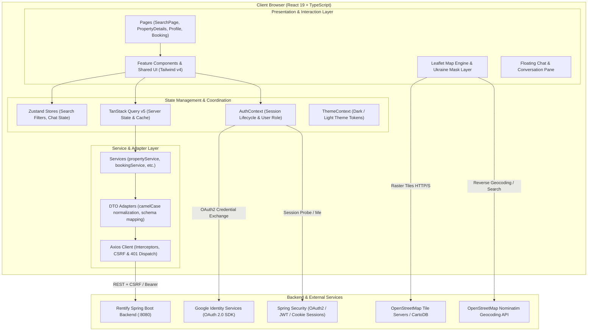
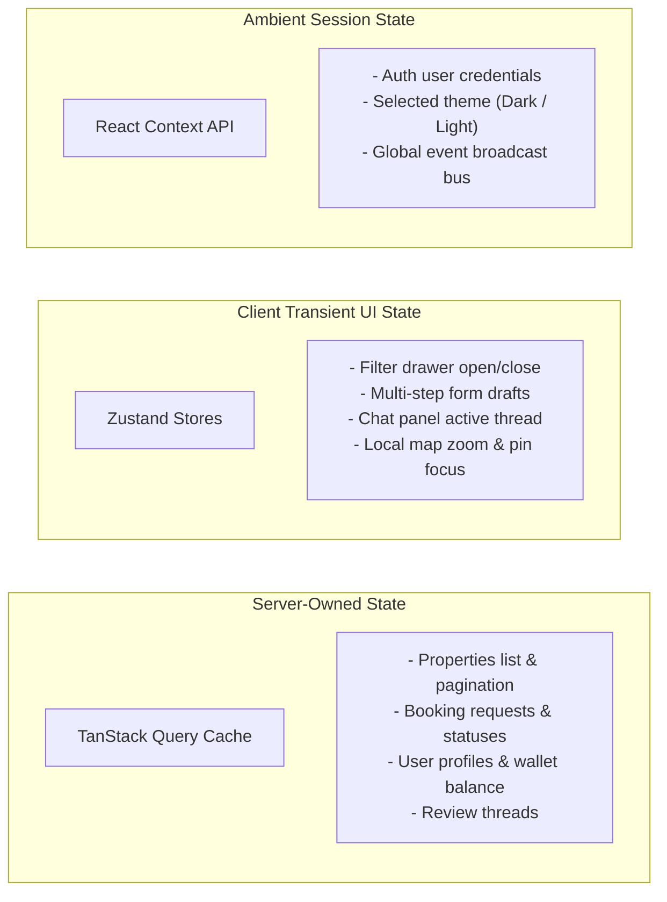
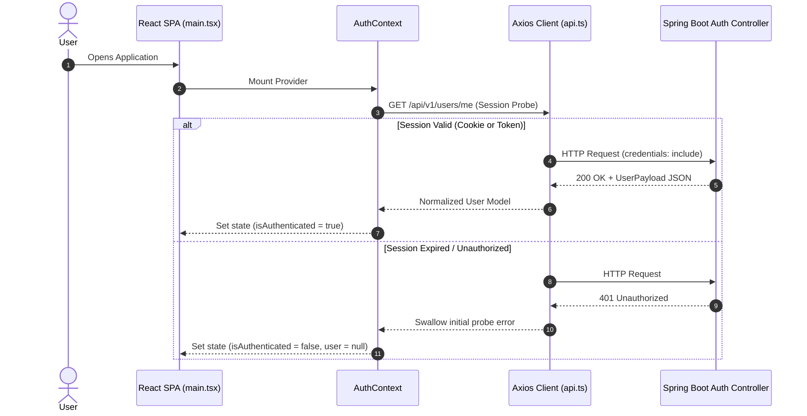
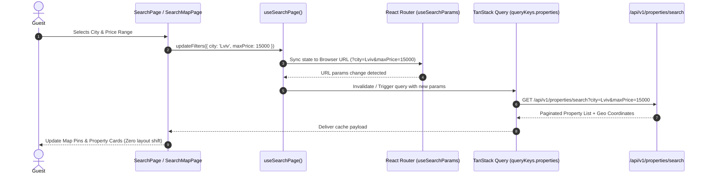

# Rentify Frontend Architecture & System Design

## 1. Overview

**Rentify Frontend** is a Single-Page Application (SPA) designed for long- and short-term property rental in Ukraine. It interfaces with the Spring Boot backend (`rentify-backend`) to deliver real-time property searching, interactive geo-spatial exploration, booking management, user messaging, profile administration, promotional boosts, and digital wallet transactions.

The architecture emphasizes:
- **Strict Layer Separation**: UI presentation is decoupled from server caching, business logic, and transport clients.
- **Dual-Strategy Session Security**: Supports both secure HttpOnly cookie sessions with CSRF double-submit protection and Bearer token headers for headless/mobile compatibility.
- **Geographic Precision**: Dedicated Ukraine polygon mask layer and bounding boxes to ensure search operations remain bounded to Ukrainian territory.
- **Deterministic State Isolation**: Clear partition between server state (TanStack Query), synchronous UI state (Zustand), and reactive session contexts.

---

## 2. High-Level System Architecture

The following diagram illustrates how the client-side single page application interacts with external services, backend micro-modules, and rendering layers:

---

## 3. Core Architectural Layers

### 3.1 Presentation Layer (`src/pages`, `src/layouts`, `src/components`)
- **Pages**: Top-level route containers registered in `src/routes/AppRouter.tsx`. Pages coordinate data subscriptions and layout composition but delegate direct rendering to feature components.
- **Layouts**:
  - `MainLayout`: Persists navigation header, breadcrumb containers, floating chat trigger, and global footer.
  - `AuthLayout`: Dedicated shell for authentication, password recovery, and onboarding journeys.
- **Components**: Grouped by domain (`auth`, `chat`, `home`, `map`, `profile`, `property`, `reviews`, `search`, `ui`). Components are strictly typed and communicate via props and Zustand actions.

### 3.2 State Management Partitioning

To avoid global store pollution and synchronization bugs, state is partitioned into three distinct tiers:

### 3.3 Service & Transport Layer (`src/services`, `src/services/adapters`)
- **Axios Singleton (`src/services/api.ts`)**:
  - Automatic `snake_case` to `camelCase` deep transformation on all incoming JSON payloads.
  - Automatic injection of `X-Requested-With: XMLHttpRequest`.
  - Automatic CSRF extraction from cookies for unsafe HTTP mutations (`POST`, `PUT`, `PATCH`, `DELETE`) when running in cookie mode.
  - Dispatches decoupled window events (`auth:session-expired`, `network:offline`) on transport failures.
- **Adapters**: Normalizes polymorphic backend responses into clean domain types (`src/types/*.ts`), isolating the UI from backend schema deprecations.

---

## 4. Key Runtime Data Flows

### 4.1 Authentication & Session Verification Flow

### 4.2 Property Search & Geo-Filter Synchronization

---

## 5. Map & Geolocation Subsystem

Rentify uses a custom geo-rendering pipeline on top of Leaflet 1.9:
1. **Coordinate Reference System**: WGS 84 (`EPSG:3857`).
2. **Boundary Protection (`src/utils/ukraineMask.ts`)**:
   - Inverted polygon GeoJSON mask covering territories outside Ukraine's borders with an adjustable opacity overlay.
   - Restricts map bounds to `[44.0, 22.0]` (South-West) and `[52.5, 40.5]` (North-East).
3. **Marker Clustering & Dynamic Pins (`src/utils/search/pinClustering.ts`)**:
   - Groups dense property pins at high zoom levels to maintain smooth 60 FPS scrolling and panning.
   - Custom SVG marker templates indicate price levels and highlight active selections.

---

## 6. Resilience & Fault Tolerance Strategy

| Failure Scenario | Detection Mechanism | Recovery Action |
| :--- | :--- | :--- |
| **Session Expiry (401)** | Axios response interceptor (`src/services/api.ts`) | Dispatches `auth:session-expired` event, clears local state, redirects to `/login` with return URL. |
| **Connection Drop** | Network event listener (`network:offline`) | Displays offline banner; TanStack Query pauses retries until connection resumes. |
| **Component Crash** | React Error Boundaries | Renders fallback UI, preventing full application crash. |
| **Tile Server Failure** | Leaflet `tileerror` event | Silently ignores failed external tiles while keeping vector markers and application UI operational. |
