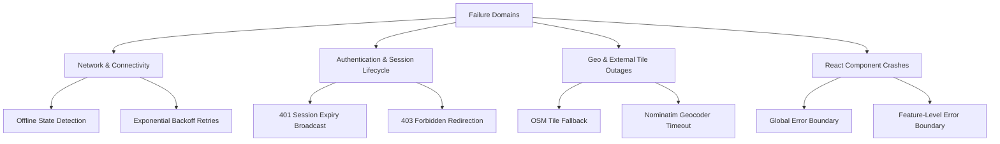
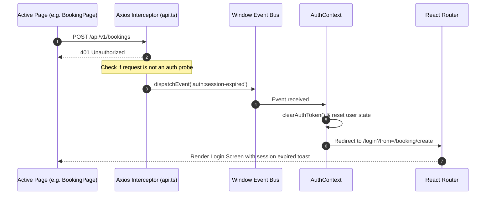

# Failures, Diagnostics & Recovery Strategies

## 1. Overview

This document specifies the fault tolerance mechanisms implemented across Rentify Frontend. The application is designed to gracefully degrade and automatically recover from network instability, session termination, external tile provider downtime, and unexpected JavaScript runtime errors.

---

## 2. Failure Domain Taxonomy



---

## 3. Network & Transport Recovery

### 3.1 Offline Detection (`network:offline`)
The Axios response interceptor (`src/services/api.ts`) detects offline network transitions when requests fail with no response object:

```typescript
api.interceptors.response.use(
  (response) => response,
  (error) => {
    if (!error.response && typeof window !== 'undefined') {
      window.dispatchEvent(new Event(NETWORK_OFFLINE_EVENT));
    }
    return Promise.reject(error);
  }
);
```

- When triggered, a non-intrusive offline status banner appears at the top of the viewport.
- TanStack Query pauses ongoing retry timers and resumes them automatically upon window `online` event emission.

---

## 4. Authentication Session Expiry & Recovery

When an access token expires or a session cookie is invalidated by the backend, requests return `401 Unauthorized`.



**Exclusions**:
- Login requests (`/sessions`, `/sessions/google`) and user registration (`/users`) do not dispatch global session expiration events; they return structured field-level errors to the form.
- The initial background session probe (`GET /api/v1/users/me`) swallows 401 silently to prevent login redirects on cold starts for anonymous visitors.

---

## 5. Map & Geolocation Resilience

The interactive Leaflet map (`src/components/map/InteractiveUkraineMap.tsx`) depends on external raster tiles (OpenStreetMap / CartoDB).

- **Tile Load Failure**: If a tile server experiences high latency or rate limiting, Leaflet handles missing tiles transparently without crashing the viewport.
- **Reverse Geocoding Fallback**: If Nominatim geocoding fails during property creation or address search, the UI falls back to manual pin placement and direct coordinate input, preventing workflow blockages.

---

## 6. React Error Boundaries

The application implements a two-tier Error Boundary strategy:

1. **Global Root Boundary (`App.tsx`)**:
   - Catches fatal application errors outside routed pages.
   - Presents a styled crash screen with options: "Reload page" and "Return to Home".
2. **Feature-Level Boundaries**:
   - Isolates complex third-party widgets (Leaflet Map, Rich Text Editor, Chat Panel).
   - If the Leaflet WebGL/Canvas context fails, the boundary isolates the map widget and displays a fallback notice ("Map could not be rendered") while keeping property lists and filters functional.
