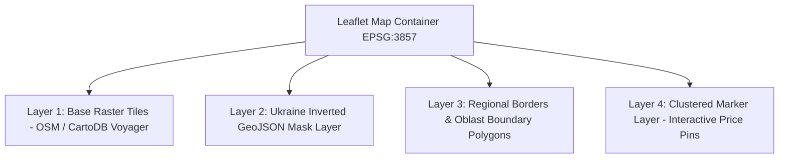

# Maps, Geolocation & Ukraine Masking Architecture

## 1. Overview

Rentify Frontend incorporates a geo-spatial engine built on **Leaflet 1.9** and **React Leaflet 5.0**. The mapping subsystem provides:
- High-performance vector and raster map rendering centered on Ukraine.
- An inverted polygon mask dimming non-Ukrainian territories to focus exclusively on Ukrainian cities.
- Dynamic marker clustering to handle hundreds of concurrent property pins with zero frame-rate drops.
- Two-way viewport synchronization with search query filters and list views.

---

## 2. Geo-Spatial Layer Stack

The Leaflet map container is composed of three synchronized visual layers:



---

## 3. Ukraine Boundary Inverted Masking (`src/utils/ukraineMask.ts`)

To restrict visual focus to Ukraine without paying for expensive private map tile APIs, Rentify uses an **inverted polygon clipping algorithm**:

1. **Outer Boundary**: A giant bounding polygon wrapping the visible earth:
   `[[-90, -180], [-90, 180], [90, 180], [90, -180]]`.
2. **Hole / Exclusion Polygon**: The official sovereign border polygon of Ukraine (including all oblasts, Autonomous Republic of Crimea, and Sevastopol).
3. **Result**: Leaflet renders an semi-opaque dark or neutral overlay across neighboring territories, highlighting Ukraine with crisp border definition.

### Coordinate Constraints:
```typescript
export const UKRAINE_BOUNDS = {
  southWest: [44.0, 22.0], // Southwestern extent (Transcarpathia / Odesa Black Sea)
  northEast: [52.5, 40.5], // Northeastern extent (Chernihiv / Luhansk border)
};
```

---

## 4. Marker Clustering & Pin Mechanics (`src/utils/search/pinClustering.ts`)

### 4.1 Cluster Aggregation Algorithm
When multiple properties exist in close proximity (e.g. downtown Kyiv or Lviv), rendering individual pins causes layout congestion and degrades mobile DOM performance.
- Pins are clustered using grid-based bounding algorithms.
- Each cluster displays the count of properties and the minimum starting price.
- Clicking a cluster initiates an animated smooth zoom directly to the bounding extent of the included properties.

### 4.2 Interactive Pin States
Each individual pin on the map has three interactive states:
- **Default**: Pill badge displaying the abbreviated price in UAH (e.g., `18 500 ₴`).
- **Hovered**: Elevates `z-index`, triggers property thumbnail card preview in map popover, and highlights corresponding list card.
- **Active / Selected**: Distinct primary brand styling with direct action link to `/property/:id`.
