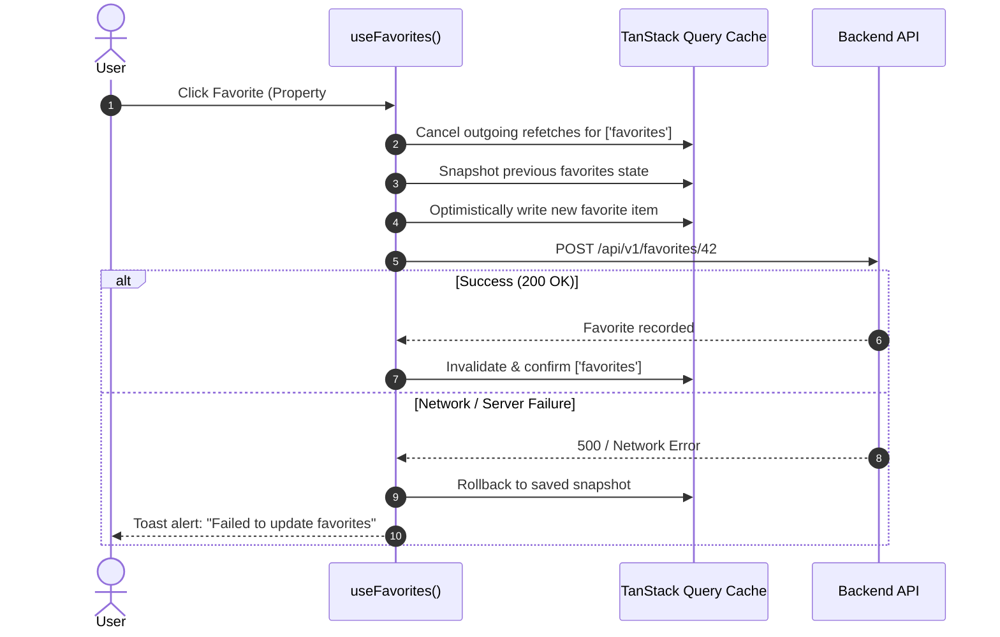

# State Management & Concurrency Strategy

## 1. State Classification Matrix

To keep state predictable and prevent synchronization bugs, Rentify Frontend separates state into four discrete categories:

| State Type | Technology | Scope | Lifetime | Examples |
| :--- | :--- | :--- | :--- | :--- |
| **Server State** | TanStack Query v5 | Global / Cached | Bound to cache TTL | Property listings, booking history, user profiles, reviews |
| **Client UI State** | Zustand v5 | Local / Shared | Browser session | Search drawer state, active modal, mobile menu, chat panel UI |
| **URL State** | React Router v6 | Global / Sharable | Deep-linkable | Search query params (`?city=Lviv&priceMin=5000&dates=...`) |
| **Ambient Session**| React Context | Global Application| App runtime | Authenticated user session, theme token (`dark` / `light`) |

---

## 2. Server-State Strategy (TanStack Query v5)

### 2.1 Query Keys Hierarchy (`src/api/queryKeys.ts`)
Query keys are structured as hierarchical tuple factories to ensure granular cache invalidation:

```typescript
export const queryKeys = {
  properties: {
    all: ['properties'] as const,
    list: (filters: PropertyFilters) => ['properties', 'list', filters] as const,
    details: (id: string | number) => ['properties', 'detail', id] as const,
    featured: () => ['properties', 'featured'] as const,
  },
  bookings: {
    all: ['bookings'] as const,
    user: (userId: string | number) => ['bookings', 'user', userId] as const,
    host: (hostId: string | number) => ['bookings', 'host', hostId] as const,
  },
  favorites: {
    all: ['favorites'] as const,
  },
};
```

### 2.2 Cache Lifecycle & Stale Times
- **Static / Rarely Changing Data** (e.g. amenities, city lists):
  - `staleTime`: 15 minutes (`15 * 60 * 1000`)
  - `gcTime` (Garbage Collection): 60 minutes
- **Dynamic Property Feeds & Search**:
  - `staleTime`: 1 minute
  - `refetchOnWindowFocus`: false (prevents disruptive refetches while browsing maps)
- **User Session & Wallet Balance**:
  - `staleTime`: 30 seconds
  - `refetchOnWindowFocus`: true

### 2.3 Optimistic Updates (e.g., Favorites Toggle)
When a user clicks "Add to Favorites", the UI updates instantaneously. If the server request fails, the cache rolls back to its previous snapshot:



---

## 3. Client UI State (Zustand v5)

Zustand handles non-persistent, transient state that should not pollute the server cache:
- **`useSearchFilterStore`**: Stores draft filter criteria before user submits the "Apply" button.
- **`useChatStore`**: Tracks whether the floating chat pane is open, the active recipient, and draft messages.
- **`useModalStore`**: Manages top-level modal dialogs (Review submit, Share listing, Booking confirmation).

**Principles**:
- Store actions must remain pure and synchronous.
- Derived values are computed with selectors to prevent unnecessary component re-renders.

---

## 4. Race Condition & Concurrency Prevention

### 4.1 Search Input Debouncing & Request Cancellation
When typing in the search bar or dragging the interactive Leaflet map, multiple network requests can be emitted in quick succession. Without proper mitigation, an earlier slow request can resolve after a faster recent request, resulting in stale data (Race Condition).

**Mitigation**:
1. **Debouncing**: Search inputs are debounced by 350ms using `useDebounce()`.
2. **AbortController**: TanStack Query automatically wires the native `signal` into Axios requests. When query parameters change, the in-flight request is aborted at the browser level:

```typescript
const { data } = useQuery({
  queryKey: queryKeys.properties.list(filters),
  queryFn: ({ signal }) => propertyService.searchProperties(filters, { signal }),
});
```

### 4.2 Mutex Protection for Session Refresh
To avoid "thundering herd" problems when access tokens expire, a promise-based mutex queue in `src/services/api.ts` ensures only one refresh request is dispatched while concurrent requests await its resolution.
