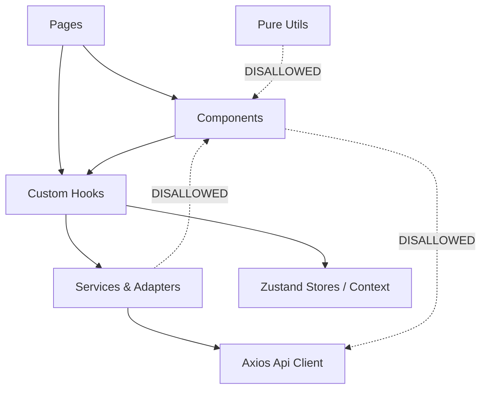

# Codebase Structure & Directory Layout

## 1. Directory Tree Overview

```text
rentify-frontend/
├── .github/                       # CI/CD Workflows, issue templates, PR templates
├── docs/                          # Architectural documentation, ADRs, specifications
│   ├── adr/                       # Architecture Decision Records
│   ├── specs/                     # Functional specifications & user journeys
│   ├── ARCHITECTURE.md            # System architecture & high-level design
│   ├── STRUCTURE.md               # Directory layout and code conventions (this file)
│   ├── STATE_MANAGEMENT.md        # Server state vs client state contracts
│   ├── THREAT_MODEL.md            # Frontend threat analysis & mitigation
│   ├── FAILURES_AND_RECOVERY.md   # Error recovery, network disconnects & boundaries
│   ├── MAPS_AND_GEO.md            # Leaflet, Ukraine mask & geo-clustering design
│   ├── PERFORMANCE.md             # Bundle optimization, lazy-loading, Web Vitals
│   └── TESTING.md                 # Test harness, Vitest, React Testing Library
├── public/                        # Static assets (favicons, manifest, geojson data)
├── src/
│   ├── api/                       # Query keys and API contracts
│   ├── assets/                    # Static images, SVG illustrations, styling assets
│   ├── components/                # Domain-specific and shared React components
│   ├── config/                    # Environment variables, map boundaries, constants
│   ├── constants/                 # Immutable application tokens, query limits
│   ├── contexts/                  # Low-frequency ambient React contexts (Auth, Theme)
│   ├── hooks/                     # Custom React hooks (domain logic & search coordination)
│   ├── layouts/                   # Shared page shells (MainLayout, AuthLayout)
│   ├── pages/                     # Top-level page routes
│   ├── routes/                    # Router configuration & protected route gates
│   ├── services/                  # HTTP clients, API modules, and DTO adapters
│   ├── test/                      # Vitest test setup, mock providers, and fixtures
│   ├── types/                     # TypeScript ambient interfaces and domain types
│   ├── utils/                     # Pure helper functions, formatting, and calculations
│   ├── App.tsx                    # Root component with providers
│   ├── index.css                  # Tailwind CSS v4 directives & theme definitions
│   └── main.tsx                   # Application DOM entrypoint
├── Dockerfile                     # Multi-stage production container build
├── nginx.conf                     # Production reverse-proxy & SPA routing config
├── package.json                   # Project dependencies and lifecycle scripts
├── tsconfig.json                  # TypeScript compiler options
└── vite.config.ts                 # Vite bundler, alias, and test runner configuration
```

---

## 2. Source Code Modules (`src/`)

### 2.1 `src/components/` — UI Component Taxonomy
Components are organized strictly by functional domain:

| Directory | Scope & Responsibility |
| :--- | :--- |
| `components/auth/` | Authentication form controls, Google OAuth buttons, and login shell wrappers. |
| `components/chat/` | Floating chat widget, conversation list, message pane, and real-time event listeners. |
| `components/footer/` | Site footer, localization switcher, and platform information links. |
| `components/home/` | Hero section, popular Ukrainian cities grid, featured properties slider, and FAQ. |
| `components/map/` | Leaflet wrapper, Ukraine base tile layers, boundary mask, and interactive pins. |
| `components/navbar/` | Main application header, search bar trigger, navigation menus, user avatar dropdown. |
| `components/profile/` | Host/guest profile dashboard, property management tabs, bookings, and digital wallet. |
| `components/property/` | Property cards, creation/editing multi-step forms, amenity selector, and image gallery. |
| `components/reviews/` | Review list, star rating widget, review submission modal, and rating breakdown. |
| `components/search/` | Search bar, filters drawer, price range slider, room count selectors, and search sorting. |
| `components/ui/` | Reusable atomic primitives (buttons, modals, input fields, badges, loaders). |

### 2.2 `src/services/` — Transport & Data Access
- **`api.ts`**: The central Axios instance. Configured with:
  - Base URL from environment (`VITE_API_BASE_URL`).
  - Automatic `snake_case` $\rightarrow$ `camelCase` response transformation.
  - Automatic CSRF extraction from cookies for unsafe HTTP methods (`POST`, `PUT`, `DELETE`).
  - Request/response interceptors with error broadcasting.
- **`services/*.ts`**: Domain API services (`propertyService`, `bookingService`, `userService`, `reviewService`, `paymentService`, `walletService`, etc.). Every service contains pure asynchronous functions returning promises.
- **`services/adapters/*.ts`**: Data Transfer Object (DTO) adapters that normalize raw backend responses into stable domain entities before reaching UI hooks.

### 2.3 `src/hooks/` — Logic & Coordination Hooks
Hooks encapsulate complex UI behaviors and data orchestration:
- **`hooks/search/`**: High-level search page coordinator (`useSearchPage.ts`), synchronization of URL params with query states (`useSearchFilterSync.ts`).
- **`hooks/usePropertySearch.ts`**: TanStack Query integration for property queries, pagination, and debounce handling.
- **`hooks/usePropertyDetails.ts`**: Query hooks for single property entity, reviews, and host metadata.
- **`hooks/useChatState.ts`**: Local chat panel state management, message typing status, and scroll position.
- **`hooks/useFavorites.ts`**: Optimistic favorite toggle mutations with rollback capability.

### 2.4 `src/types/` — Type System & Domain Contracts
All types are written in strict TypeScript without `any`:
- `types/property.ts`: Core listing entity, amenities, images, price specifications.
- `types/booking.ts`: Booking request statuses, date ranges, total price calculations.
- `types/user.ts`: User roles (`ROLE_GUEST`, `ROLE_HOST`, `ROLE_ADMIN`), personal profile metadata.
- `types/wallet.ts`: Wallet balance, transaction logs, withdrawal/deposit states.
- `types/search.ts`: Search query parameters, geo-bounding boxes, and filter criteria.

---

## 3. Dependency & Import Rules

To maintain high maintainability and prevent spaghetti code, the following architectural boundaries are enforced:



1. **Pages do not directly call Axios**: All network interactions must pass through services and TanStack Query hooks.
2. **Utils must be pure**: Files in `src/utils/` must have no side effects, no React hook invocations, and no direct DOM manipulations.
3. **No circular imports**: Modules within `components/` should not import from `pages/`. Cross-domain component imports must be minimized.
4. **Co-location of Tests**: Unit and component tests are co-located alongside the code they test (`Component.tsx` and `Component.test.tsx`).
