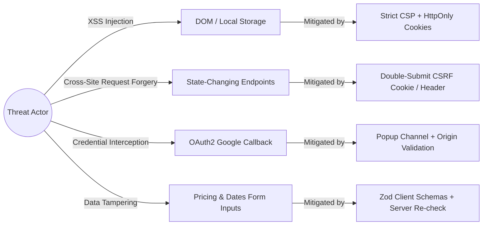

# Frontend Threat Model & Security Posture

## 1. Executive Summary

Rentify handles financial operations (wallet deposits, withdrawals, booking payments), personal identity records, and geographic property locations. This document analyzes potential client-side attack surfaces and outlines defense mechanisms following the **OWASP Top 10 Client-Side Security** guidelines.

---

## 2. Threat Surface Matrix



---

## 3. Threat Analysis & Mitigations

### 3.1 Cross-Site Scripting (XSS)

* **Threat**: Malicious actors submitting script injections in property descriptions, reviews, or chat messages.
* **Mitigation**:
  * **React JSX Automatic Escaping**: All dynamic text content is safely encoded by React's rendering pipeline.
  * **No Raw `dangerouslySetInnerHTML`**: Dynamic HTML rendering is strictly prohibited in the codebase.
  * **Input Validation**: All user inputs are sanitized and validated against strict `Zod` schemas before submission.

### 3.2 Cross-Site Request Forgery (CSRF)

* **Threat**: Malicious third-party sites issuing unauthorized state-changing requests (e.g. deleting a listing or initiating a booking) leveraging ambient cookies.
* **Mitigation**:
  * **Dual-Mode Cookie Strategy (`USE_HTTP_ONLY_AUTH_COOKIE`)**:
    * Session cookie uses `SameSite=Strict` and `Secure` flags.
    * Unsafe HTTP methods (`POST`, `PUT`, `PATCH`, `DELETE`) require a matching CSRF header (`X-XSRF-TOKEN`) extracted from the non-HttpOnly `XSRF-TOKEN` cookie.
    * Injected automatically via `src/services/api.ts`:
      ```typescript
      if (USE_HTTP_ONLY_AUTH_COOKIE) {
        const method = config.method?.toLowerCase();
        if (method && UNSAFE_HTTP_METHODS.has(method)) {
          const csrfToken = getCookieValue(CSRF_COOKIE_NAME);
          if (csrfToken) {
            setRequestHeader(config, CSRF_HEADER_NAME, csrfToken);
          }
        }
      }
      ```

### 3.3 Token Storage & Session Security

* **Threat**: Malicious scripts stealing authentication tokens from `localStorage`.
* **Mitigation**:
  * The production configuration uses **HttpOnly Cookies** by default (`USE_HTTP_ONLY_AUTH_COOKIE=true`), making tokens completely inaccessible to JavaScript (`document.cookie` cannot read HttpOnly tokens).
  * In token storage fallback mode, tokens are held strictly in memory and ephemeral storage with immediate clearing upon session termination or 401 response receipt.

### 3.4 Google OAuth 2.0 Security

* **Threat**: Token spoofing or authorization code interception during Google Login.
* **Mitigation**:
  * Google OAuth uses the official Google Identity Services SDK.
  * Authentication tokens returned from Google's credential response are submitted immediately to the backend (`/api/v1/sessions/google`) for cryptographic signature verification and profile matching.
  * The frontend never stores raw Google credentials.

---

## 4. Security Verification in CI Pipeline

Security checks are integrated into package lifecycle scripts:
- `npm run audit:deps`: Checks production dependencies for known vulnerabilities (`high` or `critical`).
- `npm run lint`: Enforces ESLint rules prohibiting dangerous DOM operations.
- `npm run security:check`: Aggregates static security and dependency audits before merge.
